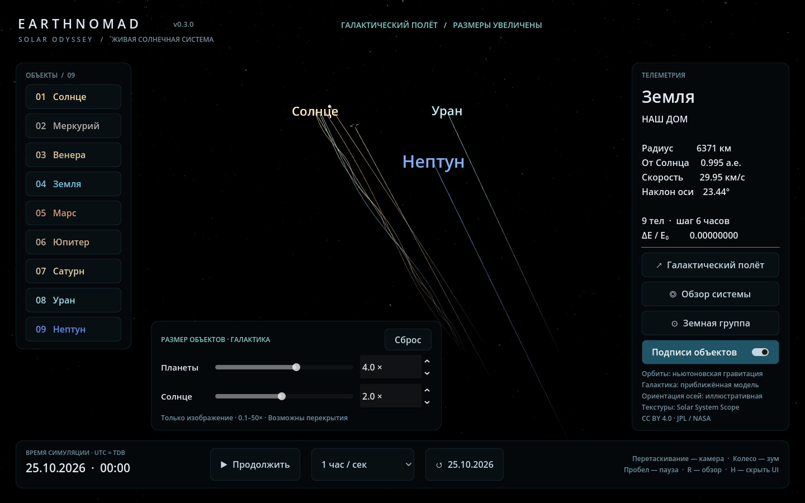
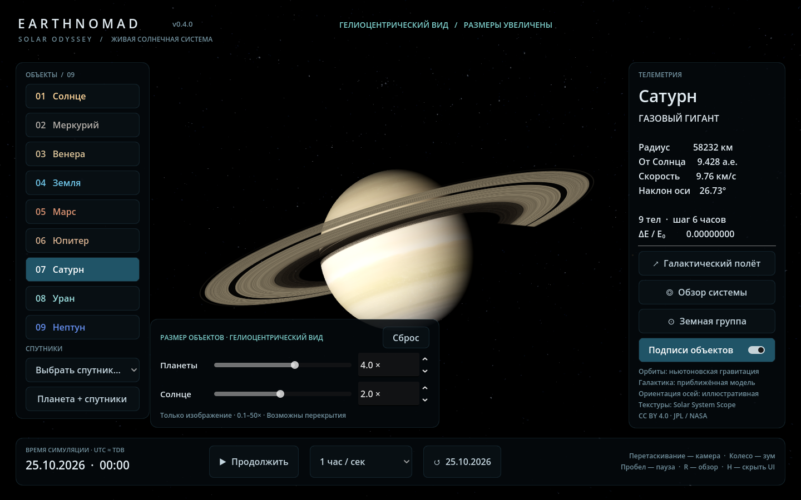
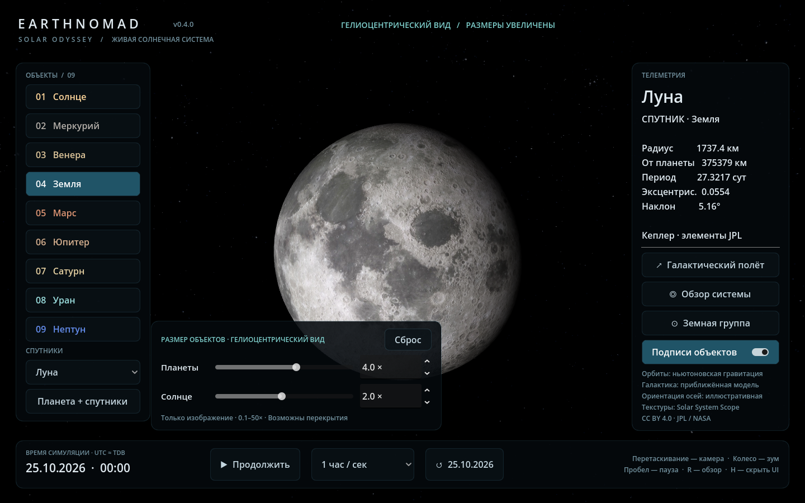

# EarthNomad · Solar Odyssey

Нативная интерактивная 3D-симуляция Солнечной системы для Windows с общей кодовой базой для Android. Текущая версия — **0.4.0**, рабочий прототип, а не научный планетарий с точностью эфемерид.

[История изменений](CHANGELOG.md) · [Версии на GitHub](https://github.com/TRSteep/EarthNomad/tags)

## Запуск

Готовая сборка: `build/EarthNomad.exe`. Запускается без установленного Godot, все ресурсы встроены. Сборка не подписана цифровой подписью.

Из исходников: открыть `project.godot` в **Godot 4.5 Standard** и нажать F6/F5 (для основной сцены — F5). В этой рабочей копии движок уже находится в `.tools`.

```powershell
./run.ps1           # приложение
./run.ps1 -Editor   # редактор
./run.ps1 -Test     # физика и сценарии приложения
./run.ps1 -RenderTest # GPU-проверка 20 спутников в обоих масштабах и колец
./run.ps1 -Build    # сборка Windows
./scripts/package.ps1 # сборка, архив с номером версии, SHA-256
```

Для новой копии репозитория `setup.ps1` устанавливает локальный движок и экспортный шаблон; текстуры уже входят в исходники. Для запуска офлайн интернет не требуется.

## Почему Godot, а не Go

Godot уже предоставляет 3D-сцену, GPU-шейдеры, камеры, UI, сенсорный ввод, импорт текстур и экспорт Windows/Android. На Go пришлось бы собирать и поддерживать этот слой отдельно. Вычисления для девяти тел слишком малы, чтобы это окупилось. GDScript использует 64-битные скаляры; при расширении до тысяч тел расчет можно перенести в C++ через GDExtension.

Unity + C# также подходит, особенно для большой команды с опытом Unity. Unreal дает более высокий потолок графики на ПК, но более тяжелый мобильный проект. Для этого компактного приложения выбран Godot, без .NET-зависимости на Android.

В версии 0.1 используется Compatibility / OpenGL с собственными шейдерами освещения. Это общий базовый профиль для ПК и Android; Forward+ с HDR/bloom, объемное рассеяние и отдельный мобильный профиль — дальнейшее развитие, а не уже реализованные функции.

## Что реализовано

- Солнце и восемь планет, взаимная ньютоновская гравитация, движение Солнца вокруг барицентра.
- Начальные состояния на **25.10.2026**, полученные из элементов JPL; интегрирование velocity Verlet, фиксированный шаг 0.25 суток.
- Галактическое перемещение всей системы, история траекторий в движущейся системе отсчета.
- Карты всех планет 2K; Земля: поверхность, облака и ночные огни 8K. Звездный фон 8K. Венера отображается с облачным покровом.
- Освещение от Солнца, терминатор, приближенное атмосферное свечение и блик на океане.
- Кольца Сатурна D/C/B/A/F с радиальными неоднородностями, щелями Кассини, Энке и Килера; 13 компонентов колец Урана, включая узкие тёмные кольца и эксцентричное ε-кольцо. Тень планеты на кольцах и колец на планете, прозрачность зависит от направления взгляда.
- Луна и ещё 19 спутников с картами поверхности, кеплеровскими орбитами, приливной ориентацией и затенением планетой.
- Вращение планет с разными периодами, включая обратное вращение Венеры и Урана.
- Масштаб расстояний линейный и единый; размеры переключаются между увеличенными и физическими.
- Плавающий центр рендера выбранного тела: вычитание координат выполняется до преобразования в 32-битный Vector3.
- Выбор планеты, общий обзор, масштабирование, пауза, ускорение и сброс времени, клавиатура, мышь и сенсорные жесты.
- В обоих видах — независимый размер планет и Солнца (0.1×–50×), числовой ввод и сохранение настроек для каждого вида.
- Подписи объектов в обзоре можно включать и выключать переключателем справа или клавишей **L**; выбор сохраняется.

## Размер объектов и навигация

Панель «Размер объектов» видна в нижней части экрана и в галактическом, и в гелиоцентрическом виде:

- **Планеты** — общий множитель отображаемого радиуса всех восьми планет (по умолчанию **4×**).
- **Солнце** — независимый множитель (по умолчанию **2×**).
- Перетащите ползунок или введите точное число от **0.1 до 50** с шагом 0.1.
- «Сброс» возвращает **4× / 2×** для текущего вида. Настройки двух видов сохраняются отдельно и автоматически восстанавливаются между запусками.

Множитель применяется к увеличенным обзорным размерам, а не к реальным километрам. Орбиты, массы, скорости и расстояния не меняются. При больших значениях планеты могут перекрываться. Режим физических размеров **T** отключает увеличение; изменение ползунка включает его обратно. В крупном плане камера подстраивается под новый радиус, в общем обзоре сохраняет положение.

Справа расположены «Галактический полёт», «Обзор системы», «Земная группа» и переключатель подписей. «Обзор системы» возвращает гелиоцентрический вид с орбитой Нептуна, «Земная группа» показывает внутренние планеты. Для приближения используйте колесо мыши или жест двумя пальцами; отдельных кнопок приближения нет.

При обновлении с 0.2.0 старая пара значений 20×/1× заменяется на 4×/2×. Другие сохранённые значения сохраняются, но ограничиваются 50×. Настройка гелиоцентрического вида начинается с 4×/2×.



## Луна и спутники

Выберите планету слева, затем нужный спутник в списке **«Спутники»**. Камера приблизится к нему, а справа появятся радиус, расстояние от планеты и период обращения. Кнопка **«Планета + спутники»** показывает систему целиком с орбитами. Подписи включаются общим переключателем **L**. Вернуться к крупному плану планеты можно кнопкой с её именем.

| Планета | Добавленные спутники |
|---|---|
| Земля | Луна |
| Марс | Фобос, Деймос |
| Юпитер | Ио, Европа, Ганимед, Каллисто |
| Сатурн | Мимас, Энцелад, Тефия, Диона, Рея, Титан, Япет |
| Уран | Миранда, Ариэль, Умбриэль, Титания, Оберон |
| Нептун | Тритон |

В локальной системе размеры планеты, спутников и расстояния между ними используют единый масштаб: Луна не становится ближе к Земле ради удобства показа. Поэтому небольшие спутники на общем плане могут быть едва видны — для деталей используйте список. В локальном виде другие планеты скрыты, чтобы их увеличенные размеры не пересекали систему; в обзоре Солнечной системы все планеты снова видны, а локальные спутниковые системы скрыты. Галактическая система отсчёта также поддерживает локальные системы спутников.

Орбиты спутников вычисляются отдельно от девятителового интегратора по приближённой двухтельной модели. Не учитываются их взаимные возмущения, прецессия, резонансы и точные текущие фазы. Параметры взяты из JPL, начальные элементы относятся к J2000. Это визуализация формы и движения орбит, а не эфемериды Horizons. См. [модель спутников и колец](docs/SATELLITES.md).

Некоторые карты Voyager покрывают лишь часть спутника. Чёрные участки на таких картах — отсутствие снимков, а не цвет поверхности. Изображение Титана показывает преимущественно оранжевую дымку; его инфракрасная карта лишь слабо просвечивает.





## Версионность и выпуск

Используется **MAJOR.MINOR.PATCH**, источник версии — файл `VERSION`. Номер также записывается в настройки Godot и Android; `run.ps1` проверяет их согласованность перед тестами, запуском и сборкой.

```powershell
./scripts/set-version.ps1 -Version 0.4.0
# Дополнить CHANGELOG.md, затем:
./run.ps1 -Test
./scripts/package.ps1
```

Скрипт обновляет `VERSION`, `application/config/version`, Android `version/name` и `version/code` (major × 1000000 + minor × 1000 + patch). После проверок создаётся аннотированный Git-тег `v<версия>`. Первая версия сохранена тегом `v0.1.0`; настройки галактических размеров добавлены в `v0.2.0`.

Сборка создаёт `build/EarthNomad.exe` и `build/EarthNomad-<версия>-Windows.exe`. Пакет — `EarthNomad-<версия>-Windows.zip` с README, историей изменений, атрибуцией текстур и лицензиями движка; рядом — контрольная сумма `.sha256`. Бинарные сборки, SDK и кэш не включаются в историю Git.

## Управление

| Действие | Управление |
|---|---|
| Поворот камеры | Перетаскивание мышью / одним пальцем |
| Приближение | Колесо, +/−, жест двумя пальцами |
| Выбор тела | Кнопки слева, клавиши 1–9 |
| Общий обзор | R |
| Вернуться к выбранной планете | F |
| Галактические траектории | G |
| Физические / увеличенные размеры | T |
| Подписи объектов в обзоре | Переключатель справа / L |
| Пауза | Пробел |
| Скрыть интерфейс | H; Esc возвращает его |

Общий обзор охватывает орбиту Нептуна. В реальном масштабе планеты почти неразличимы; используйте выбор объекта, чтобы рассмотреть его. Непрерывная скорость времени выбирается из шести режимов, от реального времени до 120 суток/сек. При низком FPS модель замедляется вместо увеличения шага интегратора.

## Научные ограничения

См. [docs/PHYSICS.md](docs/PHYSICS.md). Начальные состояния приблизительные. В девятителовом расчёте Земля–Луна остаётся единым барицентром с общей массой; в локальном изображении их положения разделяются без повторного добавления массы Луны. Остальные спутники показаны независимыми кеплеровскими моделями. Нет релятивистских поправок, взаимных возмущений спутников, приливной эволюции, столкновений и эфемерид DE440. Для Сатурна, Урана и Нептуна использованы фиксированные направления полюсов IAU; для остальных тел направления осей и начальные меридианы остаются иллюстративными. Карты не представляют текущую погоду.

Галактическая орбита — идеализированная окружность радиусом 26 000 световых лет с периодом 230 млн лет. Наклон направления движения к эклиптике выбран иллюстративно. Это **не реконструкция точного пути Солнца**; на обозримом интервале его путь почти прямой. При переходе в этот режим предварительно рассчитывается 480 суток истории обратным интегрированием.

## Android

Есть preset `Android` (ARM64), альбомная ориентация, сенсорная камера, уменьшение текстур до 2K и геометрии сфер на мобильных устройствах. APK **не собран и не проверен на устройстве**: в текущем окружении нет Android SDK/JDK.

Для экспорта установить JDK 17 и Android SDK, указать пути в Editor Settings → Export → Android, установить шаблоны Godot 4.5 через Manage Export Templates, затем Project → Export → Android. Для публикации понадобятся собственный release keystore и настройки магазина. Инструкция: https://docs.godotengine.org/en/stable/tutorials/export/exporting_for_android.html

Мобильная оптимизация пока базовая: требуются измерения FPS/памяти на реальном устройстве; 8K исходники при запуске уменьшаются до 2K, поэтому пиковая память загрузки выше конечной. Для production нужны отдельные заранее уменьшенные мобильные ассеты и адаптивная компоновка UI для небольших экранов.

## Проверки

- 10 лет интегрирования: пик относительного отклонения полной энергии `1.3182317e-7`.
- 10 лет вперед и обратно: максимальная ошибка координат `3.44e-12 AU`.
- Проверки импульса, третьего закона Ньютона, положения Земли на J2000, единиц галактической модели.
- Сценарии выбора девяти тел, масштаба, камеры, галактических следов, паузы, времени и сброса.
- Визуальная проверка рендера на Windows / NVIDIA RTX 5070 Ti Laptop.

Численная устойчивость не равна точности эфемерид: малое отклонение энергии подтверждает качество интегратора, но не устраняет погрешности начальных данных и упрощения модели.

## Источники и лицензии

Текстуры: Solar System Scope / INOVE, **CC BY 4.0**. Подробные ссылки и зеркала: [ATTRIBUTION.md](ATTRIBUTION.md).

Данные: https://ssd.jpl.nasa.gov/planets/approx_pos.html

Период движения Солнца: https://science.nasa.gov/sun/facts/

Движок: Godot Engine, MIT. https://godotengine.org/license/
